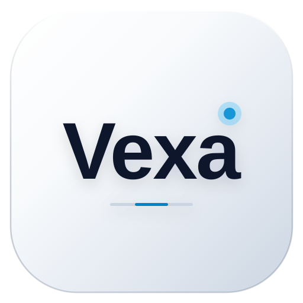

<div align="center">



# Vexa

**现代化跨平台多媒体播放器与网页工作台**

[](./LICENSE)
[](https://tauri.app/)
[](https://react.dev/)
[](https://www.typescriptlang.org/)
[](https://www.rust-lang.org/)

</div>

---

## 📥 下载与安装指南 (Download & FAQ)

可前往 [GitHub Releases 发布页面](https://github.com/HongSphere/Vexa/releases/latest) 下载适用于你系统的安装包：
- **macOS (Apple Silicon M1/M2/M3/M4)**: 下载 `Vexa_x.x.x_aarch64.dmg`，双击后将 Vexa 拖入“应用程序”文件夹。
- **Windows (x64)**: 下载 `Vexa_x.x.x_x64-setup.exe` 运行安装。

### 🍏 macOS 提示“已损坏 / 无法验证开发者”怎么办？
由于个人开源软件未购买商业 Apple 开发者签名与公证证书，macOS Gatekeeper（门禁系统）首次运行可能会拦截，提示“**已损坏，无法打开**”或“**无法验证开发者**”。

**只需按以下任一方式操作即可正常打开：**

- **✅ 方法一：终端精准解除隔离（最推荐、无需密码）**  
  将 Vexa 拖入“应用程序”后，打开 Mac 自带的“终端 (Terminal)”，运行以下命令：
  ```bash
  xattr -dr com.apple.quarantine /Applications/Vexa.app
  ```
  *(注：该命令精准移除苹果的 `com.apple.quarantine` 隔离属性，通常无需 `sudo`；若提示 Permission denied 则在前面加上 `sudo`)*

- **方法二：系统设置放行**  
  打开 Mac **“系统设置”** -> **“隐私与安全性”**，向下滚动到“安全性”板块，点击 **“仍要打开” (Open Anyway)**。

- **方法三：访达右键强制打开**  
  在“应用程序”目录中，**按住 Control 键同时右键点击 Vexa.app**，在弹出菜单中点击“打开”，再在弹窗中点击“打开”即可。

### 🪟 Windows 提示 SmartScreen 拦截怎么办？
若弹出“Windows 已保护你的电脑”蓝色提示窗口：  
点击窗口中的 **“更多信息” (More info)** -> 点击右下角出现的 **“仍要运行” (Run anyway)** 即可。

---

## ✨ 核心特性

- **现代桌面端交互与高颜值 UI**
  - 清晰直观的侧边栏导航：**网站导航** · **视频播放器** · **下载管理** · **历史与收藏** · **软件设置**。
  - 沉浸式暗黑深空主题与清爽浅色主题，支持跟随系统外观自动切换。

- **强大的流媒体播放引擎**
  - 原生支持 MP4、HLS (M3U8)、DASH 等主流流媒体协议解码与高清播放。
  - 支持多线路自由切换、画质自适应选择与音视频轨道同步。

- **Rust 原生分片流代理 (Axum)**
  - 后端内置轻量高效的 `Axum` 本地 Range 流代理服务。
  - 完整支持 `HTTP 206 Partial Content` 分片传输，进度条秒级拖拽、零卡顿缓冲。
  - 智能自适应跨域与流传输标头注入，保障各种流媒体格式顺畅加载。

- **配置驱动与高度可扩展 (Config-Driven Engine)**
  - 核心播放器与数据配置完全解耦，支持导入自定义规则包或网络订阅 URL。
  - 规则数据完全本地化存储，支持导入、导出、备份与随时一键重置。

- **多任务下载管理器**
  - 原生多线程高速分片下载引擎，支持断点续传。
  - 实时计算并展示下载速度、分片完成率以及剩余预估时间。
  - 任务完成后支持一键在本地文件管理器（Finder / Explorer）中定位文件。

- **断点续播与快捷键支持**
  - 自动记忆各视频的播放位置，支持跨会话无缝断点续播。
  - 完善的键盘快捷键控制（空格暂停/播放、方向键快进快退/音量调节、全屏切换等）。

---

## ⌨️ 快捷键速查 (Shortcuts)

| 按键 | 功能说明 |
| :--- | :--- |
| `Space` / `K` | 播放 / 暂停 |
| `←` / `→` | 后退 5 秒 / 快进 5 秒 |
| `↑` / `↓` | 增加音量 5% / 减小音量 5% |
| `F` | 切换窗口全屏 / 退出全屏 |
| `M` | 快速静音 / 取消静音 |

---

## 📄 自定义规则配置说明 (Configuration)

本项目根目录提供了标准的基础规则模板参考文件 [`sources.sample.json`](./sources.sample.json)。

规则文件标准结构示例：

```json
{
  "version": "1.0",
  "name": "我的自定义规则配置",
  "sites": [
    {
      "id": "site-id",
      "name": "站点名称",
      "homeUrl": "https://example.com/",
      "searchUrlTemplate": "https://example.com/search?q={q}",
      "color": "#38bdf8",
      "desc": "站点简介"
    }
  ],
  "vodProviders": [
    {
      "id": "provider-id",
      "name": "媒体采集源名称",
      "apiBase": "https://example.com/api.php/provide/vod/",
      "enabled": true
    }
  ],
  "parseLines": [
    {
      "id": "line-id",
      "name": "解析线路名称",
      "urlPrefix": "https://example.com/player/?url=",
      "enabled": true
    }
  ]
}
```

---

## 🚀 本地构建与开发 (Build & Run)

### 前置环境需求
- [Node.js](https://nodejs.org/) (推荐 v18 或 v20+)
- [Rust](https://www.rust-lang.org/) (推荐 1.75+，需包含 `cargo`)

### 开发步骤

```bash
# 1. 安装前端依赖
npm install

# 2. 启动前端开发调试服务
npm run dev

# 3. 启动 Tauri 桌面端开发模式
npm run tauri dev

# 4. 构建全平台可执行安装包 (.dmg / .app / .exe)
npm run tauri build
```

---

## ⚖️ 免责声明 (Disclaimer)

本项目仅供计算机软件架构技术交流与个人学习使用。软件按“原样”提供，使用者请自行承担使用本软件的相关责任与风险。

---

## 📜 开源协议 (License)

本项目基于 [MIT License](./LICENSE) 协议开源。
